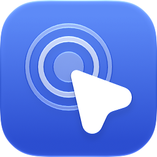
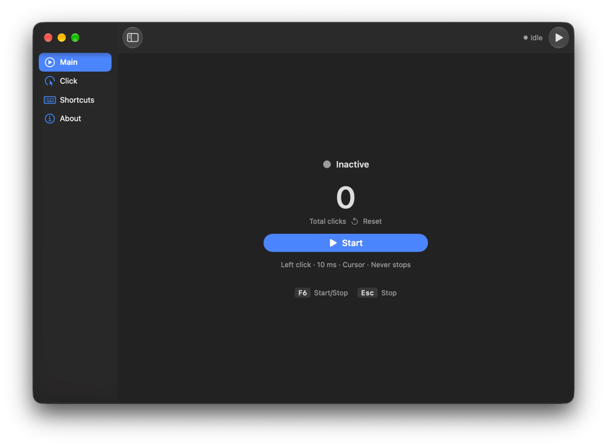
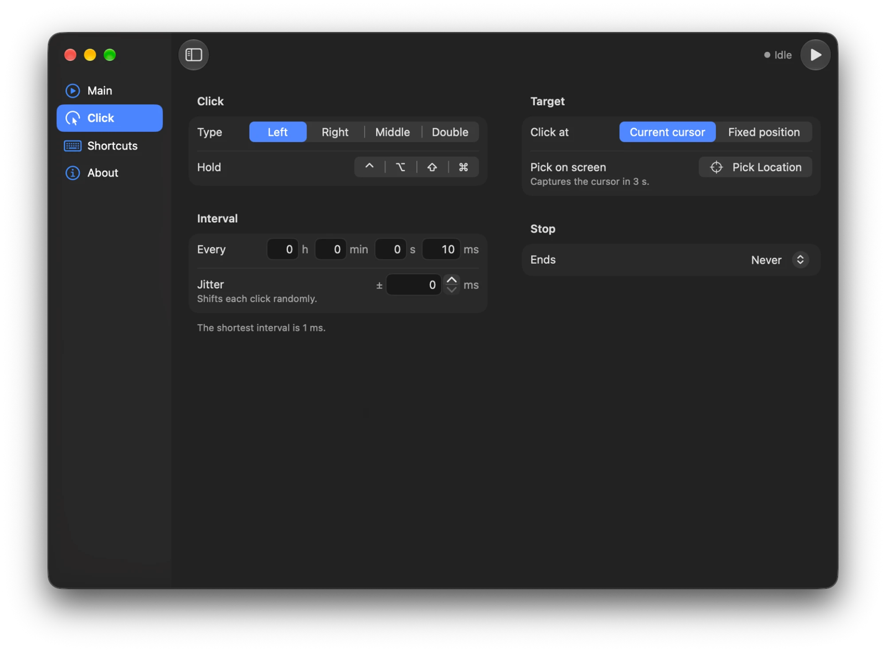
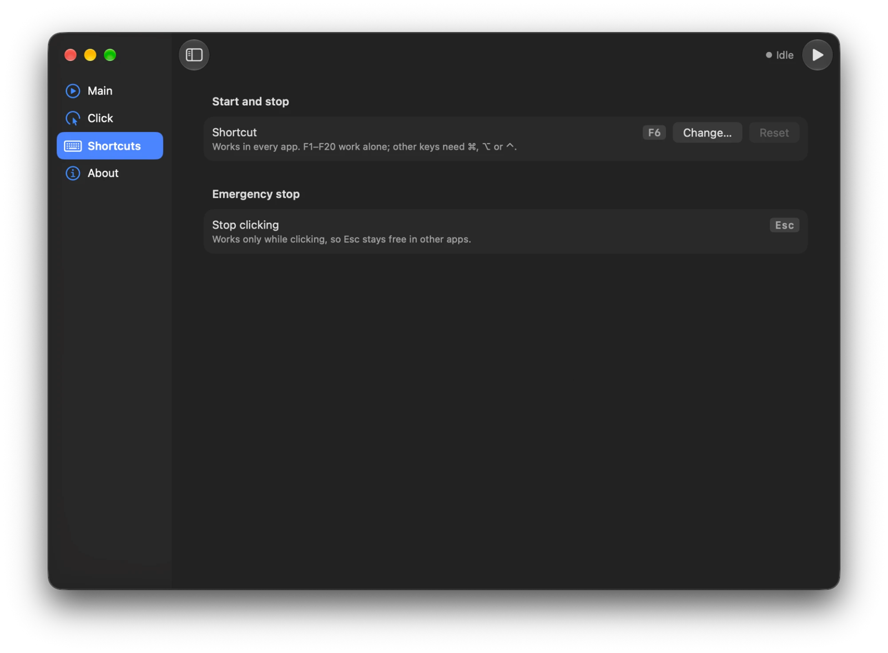
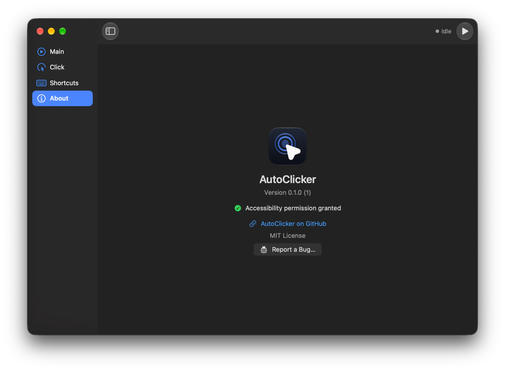

<div align="center">

<picture>
  <source media="(prefers-color-scheme: dark)" srcset="docs/images/icon-dark.png">
  
</picture>

# AutoClicker

**A precise, lightweight auto clicker for macOS.**<br>
Native Swift and SwiftUI · Apple Silicon and Intel · Free and open source

[](https://github.com/mfatihkara8/AutoClicker/releases/latest)

[](https://github.com/mfatihkara8/AutoClicker/releases/latest)
[](#install)
[](https://www.swift.org)
[](LICENSE)



</div>

## Features
- **Every click type:** left, right, middle and true double clicks.
- **Precise timing:**
  - Set the interval in hours, minutes, seconds and milliseconds, down to 1 ms, with optional random jitter.
  - Clicks follow a drift-free schedule, so the rate stays accurate over long runs.
- **Click where you want:** at the pointer, or at a fixed point on any display. **Pick Location** captures the point for you.
- **Stop on your terms:** after a number of clicks, after a set time, or never.
- **Modifier clicks:** hold <kbd>⇧</kbd> <kbd>⌃</kbd> <kbd>⌥</kbd> <kbd>⌘</kbd> while clicking, for example ⌘-click links to open them in new tabs.
- **Works from any app:** <kbd>F6</kbd> starts and stops clicking wherever you are, and you can record your own shortcut instead.
- **Built-in safety:**
  - <kbd>Esc</kbd> stops clicking at once.
  - Moving the pointer into a screen corner also stops it.
  - AutoClicker never clicks its own window.
- **Stays out of the way:**
  - A menu bar extra keeps clicking after you close the window.
  - AutoClicker uses no CPU while idle.
- **Private:**
  - Accessibility is the only permission it needs.
  - It makes no network requests and collects no data.

<p align="center">
  
</p>

## Install
1. Download **AutoClicker-x.y.z.dmg** from the [latest release](https://github.com/mfatihkara8/AutoClicker/releases/latest).
2. Open the DMG and drag **AutoClicker** onto **Applications**.
3. Open AutoClicker from Applications. The first time, macOS shows a warning, because the app is signed by an independent developer but [not notarized](#faq) by Apple:
   1. Close the warning. Don't move the app to the Trash.
   2. Go to **System Settings → Privacy & Security**.
   3. Scroll down to **Security**, click **Open Anyway** next to the message about AutoClicker, and confirm.
4. Grant **Accessibility** permission, which is needed to post clicks:
   1. Click **Request Access** in the app's banner, then **Open System Settings** in the dialog.
   2. Turn on **AutoClicker** under **Privacy & Security → Accessibility**.
   3. The banner disappears on its own, and you're ready to click.

**Requirements:** macOS 14 Sonoma or later, on Apple Silicon or Intel.

<details>
<summary>Verify the download (optional)</summary>
<br>

Compare the DMG's SHA-256 with the one in the release notes:

```sh
shasum -a 256 ~/Downloads/AutoClicker-*.dmg
```

</details>

## Usage
1. On the **Click** tab, choose the click type, interval, target and when to stop.
2. Press <kbd>F6</kbd> to start. Press it again to stop.

| Shortcut | What it does |
|---|---|
| <kbd>F6</kbd> | Starts or stops clicking from any app. You can record your own on the **Shortcuts** tab. |
| <kbd>Esc</kbd> | Stops clicking at once. AutoClicker only takes Esc while it is clicking, so other apps keep their Esc key. |
| Screen corner | Moving the pointer into any corner of a screen stops clicking. |
| <kbd>⌘</kbd> <kbd>,</kbd> | Opens the **Shortcuts** tab. |

The menu bar extra shows the status and the click count, and has Start/Stop. AutoClicker keeps running there after you close its window. To quit, choose **Quit AutoClicker** in the menu bar extra, or press <kbd>⌘</kbd> <kbd>Q</kbd> while the window is active.

<p align="center">
  
  
</p>

## FAQ

<details>
<summary><b>macOS says AutoClicker can't be opened</b></summary>
<br>

Apple notarizes apps only for members of its paid Developer Program, and AutoClicker isn't notarized. The app is still code-signed, so macOS knows who built it and that it hasn't been changed.

To open it once:
1. Go to **System Settings → Privacy & Security**.
2. Scroll down to **Security** and click **Open Anyway** next to the message about AutoClicker.

After that, it opens normally. On macOS 15 and later, Control-clicking the app and choosing **Open** no longer skips this step.

</details>

<details>
<summary><b>Why does it need Accessibility permission?</b></summary>
<br>

macOS lets an app post mouse clicks to other apps only if it has Accessibility permission. AutoClicker needs nothing else:
- Its shortcuts use the system hotkey API, so there's no **Input Monitoring**.
- It never records the screen.
- It makes no network requests.

</details>

<details>
<summary><b>Clicking doesn't start, or the permission banner won't go away</b></summary>
<br>

1. Make sure **AutoClicker** is turned on in **System Settings → Privacy & Security → Accessibility**.
2. If it's on but the banner stays, remove it from the list with the **−** button, then click **Request Access** in the app again.
3. Still stuck? Reset the permission in Terminal, then grant it again:

   ```sh
   tccutil reset Accessibility com.mfatihkara8.AutoClicker
   ```

</details>

<details>
<summary><b>F6 does nothing</b></summary>
<br>

On most Mac keyboards, the top row controls system features by default. You have three options:
- Hold <kbd>fn</kbd> (<kbd>🌐</kbd>) while pressing <kbd>F6</kbd>.
- Turn on **Use F1, F2, etc. keys as standard function keys** in **System Settings → Keyboard → Keyboard Shortcuts → Function Keys**.
- Record another shortcut on the **Shortcuts** tab.

If another app already uses the shortcut, AutoClicker shows a warning.

</details>

<details>
<summary><b>How do I stop it if something goes wrong?</b></summary>
<br>

Any of these stops clicking:
- Press <kbd>Esc</kbd>.
- Press your start/stop shortcut.
- Move the pointer into any corner of the screen.

AutoClicker also skips clicks that would land on its own window, so you can always reach the Stop button.

</details>

<details>
<summary><b>Why isn't it on the Mac App Store?</b></summary>
<br>

Mac App Store apps must run in the App Sandbox, and a sandboxed app can't post clicks to other apps.

</details>

## Roadmap
- **Planned next:** saved profiles, multi-point and sequential clicking, and a random offset around the target.
- **Later:** recording and playing back mouse and keyboard macros.

The details are in [docs/ROADMAP.md](docs/ROADMAP.md).

## Build from source
You need Xcode 27 or later.

```sh
git clone https://github.com/mfatihkara8/AutoClicker.git
cd AutoClicker
open AutoClicker.xcodeproj
```

In Xcode, select your own team under **Signing & Capabilities**, then press <kbd>⌘</kbd> <kbd>R</kbd>. Any Apple ID works. A fixed team keeps the Accessibility permission across rebuilds.

From the terminal:

```sh
# Build
xcodebuild -project AutoClicker.xcodeproj -scheme AutoClicker -destination 'platform=macOS' -derivedDataPath build/DerivedData build

# Unit tests (Swift Testing)
xcodebuild -project AutoClicker.xcodeproj -scheme AutoClicker -destination 'platform=macOS' -derivedDataPath build/DerivedData -only-testing:AutoClickerTests test

# Format and lint
swift format -i -r AutoClicker AutoClickerTests AutoClickerUITests
swift format lint -r --strict AutoClicker AutoClickerTests AutoClickerUITests
```

Release builds, performance checks and notarization are covered in [docs/RELEASING.md](docs/RELEASING.md).

## Contributing
- **Bug reports:** choose **Help → Report a Bug…** in the app, or [open an issue](https://github.com/mfatihkara8/AutoClicker/issues/new?template=bug_report.yml).
- **Pull requests:** welcome. Start with the docs below.

| Document | What's in it |
|---|---|
| [SPEC.md](docs/SPEC.md) | The requirements (the source of truth) |
| [ARCHITECTURE.md](docs/ARCHITECTURE.md) | Layers, folders, types and threading |
| [RULES.md](docs/RULES.md) | Coding, testing and git conventions |
| [DECISIONS.md](docs/DECISIONS.md) | Why things are the way they are |
| [GOALS.md](docs/GOALS.md) | Success criteria |
| [ROADMAP.md](docs/ROADMAP.md), [TASKS.md](docs/TASKS.md) | Milestones and tasks |
| [RELEASING.md](docs/RELEASING.md) | Building, checking and publishing a release |
| [CHANGELOG.md](CHANGELOG.md) | Release notes |

## License
[MIT](LICENSE) © 2026 Mehmet Fatih Kara
